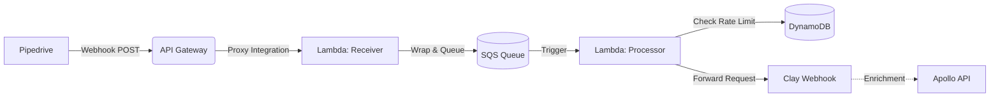

# Pipedrive to Clay 'Rate Limited' Webhook Integration

This repository contains the serverless architecture used to buffer and rate-limit webhooks sent from Pipedrive to Clay.

## 🎯 Purpose & Motivation

**The Problem:**
We are syncing data from Pipedrive to Clay. Once data reaches Clay, it triggers an enrichment workflow using the **Apollo API**. However, Pipedrive sends webhooks instantly and in bursts, while the Apollo API has strict rate limits. Sending Pipedrive data directly to Clay caused Apollo to hit rate limits and fail enrichments.

**The Solution:**
We implemented an intermediate buffering system using AWS SQS and Lambda. This system captures the Pipedrive webhooks immediately but releases them to Clay at a controlled pace (Token Bucket algorithm), ensuring we never exceed Apollo's downstream API limits.

## 🏗️ Architecture



## 🧩 Components
## **1. API Gateway**
- **Role:** Public entry point for Pipedrive webhooks.

- **Endpoint:** /pd-clay

- **Method:** POST

- **Integration:** Lambda Proxy Integration (passes full request to Receiver).

## 2. Lambda: PDWebhookReceiver (webhook_receiver.py)
- **Role:** Ingestion & Buffering.

- **Function:**

   1. Receives the raw event from API Gateway.

   2. Validates the body is present.

   3. **Transformation:** Wraps the Pipedrive payload inside a root data key (e.g., {'data': original_payload}) to match the Processor's expected format.

   4. Sends the payload to the SQS Queue.

- **Environment Variables:**

  - SQS_QUEUE_URL: URL of the SQS buffer queue.

## 3. SQS Queue (PipedriveClayWebhookQueue)
- **Role:** Asynchronous buffer. Holds messages until the Processor is ready to handle them.

- **Visibility Timeout:** Configured to allow Lambda retries if processing fails.

## 4. Lambda: PDWebhookProcessor (webhook_processor.py)
- **Role:** Rate Limiter & Forwarder.

- **Function:**

  1. Triggered by SQS.

  2. **Token Bucket Algorithm:** Checks DynamoDB to see if "tokens" (capacity) are available.

  3. **If Tokens Available:** Consumes a token, updates DynamoDB, and sends the POST request to the Clay Webhook URL.

  4. **If No Tokens:** Throws an exception to return the message to the SQS queue (retry later).

- **Key Logic:** Ensures data flows to Clay at a specific maximum requests per minute/second.

## 5. DynamoDB Table
- **Role**: State store for the Token Bucket algorithm.

- **Key:** Stores the last_updated timestamp and current_token_count.

## 🚀 Deployment
This system is currently deployed via the AWS Console.

## Prerequisites for local review:

- Python 3.x

- boto3 (AWS SDK)

- requests

## File Structure:
```
.
├── webhook_receiver.py    # Code for the Ingestion Lambda
├── webhook_processor.py   # Code for the Rate Limiting Lambda
├── requirements.txt       # Python dependencies
└── README.md              # System
```

